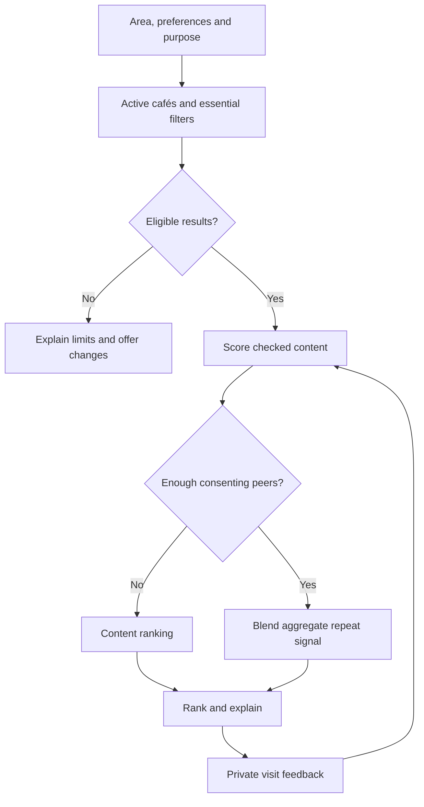

# Technical Design

Last updated: 2026-10-09. The active catalogue is PHP 8.2+/MariaDB 10.11+ under `php_app/`; `legacy_django/` preserves historical source only. D12/D13 in [DECISIONS.md](DECISIONS.md) supersede Python/Django/PostgreSQL as the active stack. [QUALITY_REVIEW.md](QUALITY_REVIEW.md) records execution evidence.

## Current Implementation Boundary

| Area | Present | Remaining |
|---|---|---|
| Foundation | PHP 8.2+, PDO native prepares, MariaDB 10.11+/InnoDB, private config plus environment, generic errors | Hostinger runtime/deployment validation |
| Catalogue | area, cafe UUID, cafe_offering; optional coordinates/prices and separate evidence fields | PHP staff admin and checked real data |
| Demo | Transactional insert-only guarded seed; eight fictional cafés, sixteen offerings, two areas; fixed UUIDs | Real sourcing; synthetic fixtures are never checked facts |
| Guest discovery | Name/area filters, stable ordering, bounded twelve-result pages, UUID details, about, 400/404/503 pages | Preferences, matching, maps and dialogs |
| Quality | Portable lint, unit, configuration, package and MariaDB/HTTP checks; CI configuration | Hosted CI and production evidence |
| Members/editorial | None | Accounts, private saves/visits, consent/deletion, curator publishing |

PHP does not auto-load `.env`. Optional private config/local.php returns allowed uppercase string values; environment overrides each value. APP_CONFIG_FILE may select an absolute private PHP file. Public paths/aliases/targets are refused. Git, Docker and ZIP packaging exclude actual credentials. `APP_ENV` defaults to production, `DEMO_MODE` defaults false and is blocked in production when true. DB_USER is explicit, DB_PORT defaults 3306, and APP_BASE_PATH is empty or a validated path prefix. Credentials remain outside Git.

## 1. Architecture and Boundaries

`public/index.php` is the front controller. `includes/request.php` validates scalar query values before SQL/rendering; `includes/catalogue.php` shares active café/area/demo rules; `includes/db.php` exposes `db_connect()` without connecting on import. Controllers pass sanitized view context; templates use `h()` for UTF-8/attribute escaping and `app_url()` for base-path-aware links.

The catalogue uses parameter binding with native PDO prepares; repeated named placeholders are prohibited by the [PDO prepare contract](https://www.php.net/PDO.prepare). Literal %, _ and ! search characters are escaped. LIMIT/OFFSET bind as integers. Results order by name then stable UUID; areas by display_order/name/slug. Queries preserve filters and clamp pages to 1..last. Invalid compound/UTF-8/control/overlong inputs return 400; unknown syntactically valid areas return an empty 200 list. Full UUID format is required, and missing/inactive/hidden records return 404.

All catalogue routes are read-only GET/HEAD; other methods return 405. The application starts with display_errors disabled, catches request failures, discards partial output and returns generic 503. Private logs record class/code without DSN, credentials or submitted input.

Local PHP routing uses `public/router.php`; Apache/LiteSpeed uses `public/.htaccess`. Only public is served. CSS is a real `public/static/site.css` asset. Root/subdirectory links use APP_BASE_PATH; never expose includes/schema/scripts through the web root.

MariaDB 10.11+ is the database target. Both schema and seed refuse disabled session CHECK/foreign-key enforcement. CHECK metadata uses MariaDB CHECK_CONSTRAINTS; PDO keeps its native mysql driver. Tables use InnoDB, foreign keys, utf8mb4 and explicit nulls for unknown values. The seed owns fixed demo identifiers, inserts missing fixtures, checks collisions and commits one transaction. Reruns preserve existing values, dates, URLs and unrelated records. Schema DDL is not treated as transactional. Existing installations need the documented additive upgrade rather than destructive recreation.

There is no staff/member authentication in PHP yet. Implement authorized admin, CSRF-protected mutations, ownership and least-privilege accounts as a separate increment. No general API, background service, AI model or mobile app is needed for catalogue browsing.

## 2. Proposed Data Model

This table describes the full target model. Only `Area`, `Cafe` and `CafeOffering` are currently implemented as product models, in the PHP schema; member/authentication tables are not present. `Area` currently has name, slug, city, active status and display order; map center/bounds are future fields. The source files and committed migrations define the exact current schema.

| Entity | Core fields and responsibility | Important rules |
|---|---|---|
| User | Future authentication identity | No private histories in public profile responses |
| TasteProfile | One user; drink preferences, preferred drink budget, soft ambience preferences, optional favourite café IDs | Favourites optional, up to three; preferences remain editable |
| Area | City/area name, stable slug, display order, center/bounds and enabled status | Only enable areas with checked catalogue data; one-city pilot |
| Cafe | Stable UUID, name, area, address, coordinates, active status, public contact/website, brand-location count and separate ownership-status provenance | Validate coordinates and their correspondence to address; unknown count/status gives no corresponding verified badge |
| CafeOffering | Café, drink category, brewing method, indicative price/currency, source and checking date | Prices are estimates, not guaranteed quotes; unknown stays unknown |
| CafeObservation | Café, attribute, value, source type/link, checked date, notes | Amenities use yes/no/unknown; separate observations from facts |
| EditorialReview | Café, curator, approved public display name, visit/publication dates, optional coffee/experience/trip scores, original notes, draft/published status | Scores nullable or 1–5; draft/private text excluded; permission to publish attribution recorded |
| Bookmark | User and café | Unique pair; ownership checked server-side |
| Visit | Stable UUID, user, café, local visit date, optional drink/brewing context/spend band, purpose, coffee/vibe ratings and return feedback | Ratings optional 1–5, no numeric default; self-reported; prevent future dates; owner can edit/delete |
| ConsentRecord | User, purpose, notice version, choice, timestamp, withdrawal time | Separate community contribution from core service choices |
| CorrectionReport | Café, disputed field, proposed correction, optional contact, status | Restricted review queue; no reporter profile displayed publicly |
| AdminAudit | Actor, time, operation, object ID, safe change summary | No secrets or full private histories in audit payloads |
| PilotEvent | Event name, time, short-lived pseudonymous session/member key, allowlisted properties | Optional minimal measurement; retention and notice defined first |

Use database constraints for unique relationships and valid values, and migrations for schema changes. Do not use café names as primary keys. Keep normalized attributes searchable; define controlled tags before using them in ranking. Raw interview material belongs outside the application database and Git.

### Explicit fields and defaults

The Cafe count/ownership fields below are present in the first source increment. EditorialReview and Visit fields remain proposed; neither model exists yet. Use nullable MariaDB columns and explicit PHP validation; inspect the actual schema before extending it.

| Field | Proposed value/default | Validation and meaning |
|---|---|---|
| `Cafe.brand_location_count` | Optional integer; unknown/null initially | At least 1 when known; worldwide brand count under the confirmed collection policy; source, scope and checking date required for a verified label |
| `Cafe.independence_status` | Choice: `unknown`, `verified_independent`, `verified_not_independent`; default `unknown` | Ownership evidence and checking date required for either verified state; a low location count does not establish independence |
| `Cafe.brand_count_source` / `brand_count_checked_on` | Empty source / null date until checked | Reference evidence without inventing a count or date; preserve count scope explicitly |
| `Cafe.independence_source` / `independence_checked_on` | Empty source / null date until checked | Record ownership evidence separately from branch-count evidence |
| `EditorialReview.coffee_rating` / `EditorialReview.experience_rating` | Optional integers 1–5; null when omitted | Public curator opinion only after authorized publication; no default score |
| `EditorialReview.notes` | Original text; empty when absent | Single source for curator notes; do not duplicate a mutable `Cafe.curatorNote` |
| `Visit.coffee_rating` / `Visit.vibe_rating` | Optional integers 1–5; null when omitted | Member's private experience of this visit; no preselection and no default 5 |
| `Visit.would_return` | Optional yes/no; null until explicitly answered | Missing feedback is neither a positive vote nor an explicit negative answer |

For optional numeric/boolean values, allow SQL NULL and explicit form omission. Use controlled choices and form validation, plus database constraints permitting null or integers within 1–5 for ratings, and null or values at least 1 for counts. Validate evidence requirements when publishing verified labels. Adding a field to existing visits must leave old, unanswered values null; never backfill 5/5 scores.

Derive count-based small-group eligibility from a checked count of at most five. A filter explicitly promising independent ownership also requires `independence_status == verified_independent` and current evidence. There is no `isIndependent=True` default. Do not persist a second badge boolean that can diverge from its evidence without an explicit invalidation rule.

The proposed future evidence policy requires a nonempty source and a checking date from today through 30 days ago for current evidence, and use a worldwide count for `is_small_group`. Dates older than 30 days are stale; missing sources/dates, whitespace-only sources and future dates give incomplete evidence. Public café/offerings views display these states. Ownership labels require current separate evidence; stale ownership requests a recheck. PHP input validation and schema constraints must check date/coordinate ranges and separate ownership evidence; database constraints cover selected invariants. The actual independent/small-group collection/filter and owner policy confirmation remain future work. Programmatic imports must call validation explicitly; executing an INSERT alone does not replace application validation.

Capture optional drink/brewing context and visit purpose alongside ratings. Keep member ratings separate from curator scores; neither is automatically added to the baseline or R. R still uses the defined consenting repeat/return signal. Missing `would_return` does not count as a positive vote. Compare feedback usefulness and ranking outcomes before proposing new weights or learned signals.

Today's purpose and filters are request/session choices; a profile may provide editable defaults. Optional favourites give quick access to familiar places and can prompt the user to confirm known drink preferences. Do not silently infer a preference from a favourite or visit. The initial score uses explicit preferences; feedback can suggest profile edits and inform later tuning.

For this small catalogue, calculate distances in application code and filter against the user's chosen radius. Validate coordinates and handle absent location. Store café coordinates; avoid persisting exact user coordinates. Add spatial indexing only if scale and measured query behaviour justify it.

### Map, search and detail delivery

Only ordinary server-rendered name/area search, list-area chips and full detail URLs exist now. The remaining map/dialog behaviour in this subsection is planned. The current query returns empty results for well-formed unknown areas and rejects searches longer than 180 Unicode characters, preserves valid filters across pagination, and excludes inactive cafés and inactive areas. Browser GPS and JavaScript are unnecessary for this slice.

Use one filtered queryset/result snapshot for list items and map markers. Apply active/area/name/essential filters before serialization, so a marker cannot bypass a requirement or reveal an archived café. Keep café UUIDs consistent between markers, list entries, dialogs and `/cafes/<uuid>/` pages. If live map refresh is needed, add the narrow read endpoint below; a separate general API is not required.

The proposed Leaflet client loads on deliberate map activation, with clear attribution and a list fallback. Once activated, offer a map-first layout using most of the available viewport and an obvious map/list toggle. Create original coffee-cup marker artwork with meaningful café-name labels and keyboard-accessible list equivalents; do not copy the reference's branding or rely on an icon alone. Configure a licensed tile service, allowed domains, terms, request limits and costs. Use only provider-approved, restricted browser-visible keys; keep server credentials private. A free map library does not grant unrestricted tile service. See [map references](SOURCES.md#s15-leaflet-map-client) and [feature acceptance](FEATURES_REFERENCE.md).

Floating area chips fit the chosen area's configured bounds and update list scope. Give them clear selected state and keyboard access without covering essential map/list controls on small screens. Name search trims input and applies a case-insensitive partial match; debounce client refresh and prevent an old response replacing newer results. Keep preferences unchanged, explain empty results, and make clearing search predictable. Do not treat panning alone as permission to silently broaden essential location filters.

Dialogs reuse the full detail page content with proper labels, keyboard focus management, Escape/close handling and focus return. Render original review notes as escaped text; do not insert untrusted HTML into Leaflet popups or dialogs. Scores, dates and authorship are shown explicitly, with no icon-only meaning. The public serializer exposes only published café/editorial fields, never member identities, private visit logs, draft notes or contribution cohorts. Personalized responses must not use shared public caching.

The Log visit action opens `/visits/` with the selected café prefilled using a validated ID. Opening the dialog or form never creates a Visit; only a CSRF-protected, authorized POST after deliberate submission does. For guests, preserve the selected café through sign-in using a same-origin return target, then revalidate the café on return. Private existing logs appear only in the member's authorized history.

Directions use an allowlisted maps-provider URL constructed from validated café coordinates or an encoded checked address. Do not append an origin or precise member location. Verify the destination against the catalogue before publishing; omit the link when neither coordinates nor address is reliable. A directions link is external navigation, not an in-app routing/booking service. [Google Maps URL reference](SOURCES.md#s16-google-maps-urls).

Google Maps is the initial candidate supported by the observed reference link. Apple Maps is a later provider option requiring current official URL/device checks and destination tests; its presence in the reference was not established. Do not add a routing API dependency for ordinary external links.

Keep coffee, experience and trip-value editorial scores outside the initial ranking formula. Member visit feedback remains private; publishing it is not part of the curator workflow. Store original curator notes and public-attribution permission, with auditable revisions. Local-collection eligibility uses the recorded brand-location count, scope/source/date and confirmed policy in [FEATURES_REFERENCE.md](FEATURES_REFERENCE.md).

## 3. Matching Baseline

### Eligibility before scoring

1. Select active cafés within the chosen area/radius.
2. Apply explicitly marked essential requirements. A required attribute with unknown or stale evidence does not qualify; use the catalogue's proposed 30-day freshness policy.
3. For a hard budget ceiling, require a recently checked price for at least one selected drink within that ceiling. Explain that the listed price is indicative; no hard budget match is possible with unknown pricing.
4. If nothing qualifies, explain the constraints and offer user-controlled changes. Never silently change them.

### Content scores

Use versioned, deterministic scores between 0 and 1:

- **T — taste:** proportion of the selected drink/brewing preferences supported by the café's checked offerings.
- **P — purpose:** proportion of the user's desired attributes for today's purpose that are confirmed present. Start with explicit user-selected attributes rather than assuming every work visit requires Wi-Fi or every date requires low noise.
- **B — budget:** 1 if a checked selected-drink price fits the spending band, 0.5 if it exceeds the band by no more than 20%, otherwise 0. A hard ceiling has already been enforced during eligibility.

A known absent attribute scores 0 for that dimension. Unknown soft attributes are omitted from that dimension's denominator and reported as unknown. If an entire dimension is unknown or unselected, omit that dimension and renormalize its remaining weights. Require at least one supported selected taste or purpose attribute for a personalized match; otherwise show a clearly labelled area browse list. This avoids presenting sparse records as highly certain matches.

Track evidence coverage separately from score. Resolve equal scores by greater relevant evidence coverage, then shorter distance if available, then stable café ID. Show missing information in the result, not a confidence percentage. These rules and the 20% budget tolerance are initial hypotheses to evaluate, not measured predictors.

### Optional community score

Initial proposed weights:

```text
score = 0.40 × T + 0.30 × P + 0.20 × B + 0.10 × R
```

**R** is disabled until there are at least **five distinct consenting comparable participants who visited that café** in the preceding 90 days, excluding the requesting user. Compare shared drink tags with Jaccard similarity, initially requiring similarity at least 0.5 and at least one shared tag. Filter to the same purpose when the requester selected one. These thresholds are proposed and must be recorded with the algorithm version.

Among those eligible peers, give each person one vote. A positive vote requires visits on at least two distinct dates in that window and their latest return feedback to be yes. Other eligible visitors remain in the denominator. Set R to positive votes divided by eligible distinct visitors, preventing one frequent visitor from dominating the signal. Logs are self-reported, so this is a community signal rather than verified purchasing behaviour.

With too little eligible data, omit R and renormalize the available content weights. With all T/P/B available, this gives weights 4/9, 3/9 and 2/9. Withdrawal, profile changes and deleted visits must invalidate affected aggregates. The five-person threshold reduces disclosure risk; it does not guarantee anonymity. See [DATA_AND_PRIVACY.md](DATA_AND_PRIVACY.md).



Recommend unvisited cafés in a discovery mode when that history is available; provide an explicit option to include familiar cafés. A future “regulars” view can serve repeat choices. Do not let the feedback loop continually show only the same popular cafés; examine coverage and user outcomes before introducing exploration rules.

### Explanations and evaluation

Create explanations directly from the features used: a confirmed drink, a selected amenity, a listed price and its verification date. Mention aggregate repeat evidence only when the threshold is met, without individual names or histories. Do not claim “friends visited,” “open now” or a percentage match without implementing the required evidence.

Version the score configuration and record the version alongside test/pilot results. Compare the baseline against a simple location-and-purpose list before increasing complexity. Experiment changes must preserve essential filters and consent handling.

## 4. Web Routes: Current and Planned

The three current routes are listed below. They serve the catalogue/admin increment only; product member routes and JSON/map endpoints remain planned. Prefer server-rendered forms first; add a JSON API only when an actual client needs it.

| Current route | Methods | Current behaviour |
|---|---|---|
| `/` | GET, HEAD | Public alphabetical list with validated `q`, `area` and `page` inputs; twelve results per page |
| `/cafes/<uuid>/` | GET, HEAD | Active café in an active area; hidden demo/inactive/missing records return 404 |
| `/about/` | GET, HEAD | Project purpose, current limitations and fictional-data notice |

The target interface below expands current routes and adds later ones; it is not an availability list:

| Route | Method | Access and effect |
|---|---|---|
| `/` | GET | Guest/member discovery; validated query preferences |
| `/cafes/<uuid>/` | GET | Active public café details |
| `/cafes/map-data/` | GET | Guest/member read of the same validated result set, serialized public café fields only; personalized responses privately cached or uncached |
| `/collections/local/` | GET | Published eligible local/small-group collection, with criteria and checking dates |
| `/about/` | GET | Collection method, curator context, limitations and correction route |
| `/preferences/` | GET, POST | Member reads/updates own profile |
| `/saved/` | GET | Member's own shortlist |
| `/cafes/<uuid>/save/` | POST | Member toggles own bookmark; CSRF protected |
| `/visits/` | GET, POST | Member's own list and new log |
| `/visits/<uuid>/edit/` | GET, POST | Owner-only edit |
| `/visits/<uuid>/delete/` | POST | Owner-only deletion |
| `/account/data/` | GET, POST | Own export, contribution choices and confirmed deletion request |
| `/cafes/<uuid>/report/` | POST | Validated correction, rate-limited |
| `/admin/` | GET, POST | Authorized staff only; model permissions constrained |

State-changing operations use CSRF protection and server-side authorization. Never trust a submitted user ID as ownership proof. Do not delete records with GET requests. Account deletion requires a confirmation flow and appropriate reauthentication.

## 5. Implementation and Testing Priorities

Complete integrated catalogue checks first, then add testable eligibility and content score computation. Content-based matching precedes community signals. Cache only when measured need exists; any cached personal/community results require invalidation on changes and deletion. Current commands and test evidence are linked from [GETTING_STARTED.md](GETTING_STARTED.md) and [QUALITY_REVIEW.md](QUALITY_REVIEW.md). The cases below describe broader pilot requirements; they are not all present in the first suite.

Necessary behavioural checks include:

- User B cannot read, change, export or delete user A's bookmarks, visits or profile by altering an ID.
- Duplicate bookmarks are prevented; invalid coordinates, future visit dates and malformed prices fail validation.
- Empty catalogue, no favourites, no location permission, no peers and missing attributes all produce understandable outcomes.
- Essential constraints never relax automatically; unavailable peer signals produce the documented content fallback.
- Consent withdrawal and visit/account deletion remove the user from derived signals and explanations.
- Catalogue editors cannot inspect private histories through the admin, exports or search.
- Forms work on mobile and keyboard; error messages preserve non-sensitive input.
- Map/list IDs remain identical across name, area, purpose and essential filters; clearing/no-results and missing-coordinate cases work.
- Tile/key/network failures preserve list and full-detail access; area controls work with real pilot data.
- Dialogs and named markers are keyboard accessible; malicious review text renders harmlessly; drafts/private fields never enter public map payloads.
- Directions links identify the correct café and omit user coordinates; editorial scores stay out of personalized ranking.
- Schema upgrades, transactions and main journeys pass against the target MariaDB engine before deployment.
- A backup can actually be restored, with deletion records reapplied before serving restored data.

Run the implemented PHP lint, unit and disposable MariaDB/HTTP checks from GETTING_STARTED.md. Local passes alone are not proof of a safe deployment.

## 6. Deployment and Operations

Hostinger Shared Web Hosting is the selected target under D12; it is not deployed or verified by this review. Keep only public files in the document root, preserve include layout, configure PHP 8.2+/pdo_mysql and private config/local.php, disable demo mode, use HTTPS and protect logs. Confirm the host's actual database engine/version and constraint enforcement; local MariaDB passes do not establish actual Hostinger deployment success. Follow HOSTINGER_DEPLOYMENT.md for the allowlisted ZIP, guarded production schema command, myfanverse.in DNS and HTTPS.

Review schema upgrades, back up valuable data, exercise restore/rollback and audit real catalogue evidence before any pilot. Separate development/test/production credentials; never run demo seeds or destructive integration checks against production. Staff authentication, permissions, privacy notices, support ownership and account/data controls remain release prerequisites when those features arrive.

Map tiles, attribution, API-key restrictions and costs, transactional email, monitoring and retention require their own approved configuration. No provider purchase, deployment, public launch or outreach is authorized by this document.

## 7. Future Expansion Triggers

Improve MariaDB queries/indexes only for measured needs. Consider spatial storage, workers or additional clients when actual scale and user evidence justify them. Keep the deterministic matching and privacy rules below as proposed contracts, with actual implementations and version choices recorded separately.
