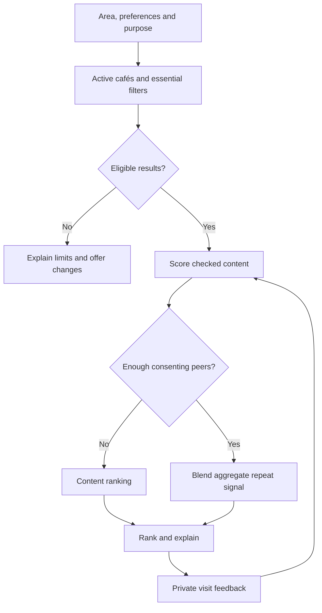

# Technical Design

Last updated: 2026-10-06. Status: proposed architecture; none of the components below are implemented.

## 1. Architecture and Boundaries

Start with one Django application serving responsive HTML/CSS and ordinary forms, enhanced with a map and accessible café detail dialogs. Use Django authentication, sessions, CSRF protection, ORM and a restricted admin. This is sufficient to test catalogue discovery and feedback without operating separate mobile apps, an API gateway, background workers or a large-model service.

| Component | Proposed choice | Reason and limit |
|---|---|---|
| Runtime | Python 3.13, maintained micro release | Supported by Django 5.2; check compatibility when dependencies change |
| Framework | Latest maintained Django 5.2 LTS patch | Built-in forms, auth and admin; support ends April 2028, so schedule a version review |
| Presentation | Server-rendered templates, responsive CSS, map/dialog JavaScript | Progressive enhancement; usable list and full detail pages remain available |
| Database | SQLite only for initial local skeleton; PostgreSQL for pilot | Pilot needs durable multi-user storage and production-equivalent tests |
| Authentication | Default Django user plus a one-to-one taste profile | Avoid custom authentication requirements during initial migrations |
| Matching | Deterministic feature scores, followed later by an optional aggregate signal | Useful with no interaction history; easy to inspect and compare |
| Location and map | Selected area, optional temporary coordinates for distance, proposed Leaflet client with licensed tiles | Small catalogue uses Haversine distance; map included in pilot, PostGIS optional later |
| Hosting | Managed web process plus persistent database; provider undecided | Choose for backups, reliability, cost and data handling |

PostgreSQL 17 is a proposed starting version if supported by the selected host; choose a maintained version compatible with the actual Django and database-driver releases. Record the final dependencies and versions in code. See [SOURCES.md](SOURCES.md) for framework and deployment references.

The initial default-user flow is username/password authentication. Email-only login, verification and password recovery require deliberate implementation and email delivery; do not assume the default skeleton provides them. Restrict staff roles explicitly and do not grant catalogue editors superuser access.

## 2. Proposed Data Model

| Entity | Core fields and responsibility | Important rules |
|---|---|---|
| User | Django authentication identity | No private histories in public profile responses |
| TasteProfile | One user; drink preferences, preferred drink budget, soft ambience preferences, optional favourite café IDs | Favourites optional, up to three; preferences remain editable |
| Area | City/area name, stable slug, display order, center/bounds and enabled status | Only enable areas with checked catalogue data; one-city pilot |
| Cafe | Stable UUID, name, area, address, coordinates, active status, public contact/website, brand-location count and separate ownership-status provenance | Validate coordinates and their correspondence to address; unknown count/status gives no corresponding verified badge |
| CafeOffering | Café, drink category, brewing method, indicative price/currency, source and checking date | Prices are estimates, not guaranteed quotes; unknown stays unknown |
| CafeObservation | Café, attribute, value, source type/link, checked date, notes | Amenities use yes/no/unknown; separate observations from facts |
| EditorialReview | Café, curator, approved public display name, visit/publication dates, optional coffee/experience/trip scores, original notes, draft/published status | Scores nullable or 1–5; draft/private text excluded; permission to publish attribution recorded |
| Bookmark | User and café | Unique pair; ownership checked server-side |
| Visit | Stable UUID, user, café, local visit date, optional drink/brewing context/spend band, purpose, coffee/vibe ratings and return feedback | Ratings optional 1–5, no numeric default; self-reported; prevent future dates; owner can edit/delete |
| ConsentRecord | User, purpose, notice version, choice, timestamp, withdrawal time | Separate community contribution from core service choices |
| CorrectionReport | Café, disputed field, proposed correction, optional contact, status | Restricted review queue; no reporter profile displayed publicly |
| AdminAudit | Actor, time, operation, object ID, safe change summary | No secrets or full private histories in audit payloads |
| PilotEvent | Event name, time, short-lived pseudonymous session/member key, allowlisted properties | Optional minimal measurement; retention and notice defined first |

Use database constraints for unique relationships and valid values, and migrations for schema changes. Do not use café names as primary keys. Keep normalized attributes searchable; define controlled tags before using them in ranking. Raw interview material belongs outside the application database and Git.

### Explicit fields and defaults

The following are proposed Django field semantics, not an implemented migration or Prisma schema. See the [official field and constraint references](SOURCES.md#s18-django-fields-and-constraints) before writing models.

| Field | Proposed value/default | Validation and meaning |
|---|---|---|
| `Cafe.brand_location_count` | Optional integer; unknown/null initially | At least 1 when known; worldwide brand count under the confirmed collection policy; source, scope and checking date required for a verified label |
| `Cafe.independence_status` | Choice: `unknown`, `verified_independent`, `verified_not_independent`; default `unknown` | Ownership evidence and checking date required for either verified state; a low location count does not establish independence |
| `Cafe.brand_count_source` / `brand_count_checked_on` | Empty source / null date until checked | Reference evidence without inventing a count or date; preserve count scope explicitly |
| `Cafe.independence_source` / `independence_checked_on` | Empty source / null date until checked | Record ownership evidence separately from branch-count evidence |
| `EditorialReview.coffee_rating` / `EditorialReview.experience_rating` | Optional integers 1–5; null when omitted | Public curator opinion only after authorized publication; no default score |
| `EditorialReview.notes` | Original text; empty when absent | Single source for curator notes; do not duplicate a mutable `Cafe.curatorNote` |
| `Visit.coffee_rating` / `Visit.vibe_rating` | Optional integers 1–5; null when omitted | Member's private experience of this visit; no preselection and no default 5 |
| `Visit.would_return` | Optional yes/no; null until explicitly answered | Missing feedback is neither a positive vote nor an explicit negative answer |

For optional numeric/boolean values, use `null=True` and `blank=True` so both storage and forms allow omission. Use controlled choices and form validation, plus database constraints permitting null or integers within 1–5 for ratings, and null or values at least 1 for counts. Validate evidence requirements when publishing verified labels. Adding a field to existing visits must leave old, unanswered values null; never backfill 5/5 scores.

Derive count-based small-group eligibility from a checked count of at most five. A filter explicitly promising independent ownership also requires `independence_status == verified_independent` and current evidence. There is no `isIndependent=True` default. Do not persist a second badge boolean that can diverge from its evidence without an explicit invalidation rule.

Capture optional drink/brewing context and visit purpose alongside ratings. Keep member ratings separate from curator scores; neither is automatically added to the baseline or R. R still uses the defined consenting repeat/return signal. Missing `would_return` does not count as a positive vote. Compare feedback usefulness and ranking outcomes before proposing new weights or learned signals.

Today's purpose and filters are request/session choices; a profile may provide editable defaults. Optional favourites give quick access to familiar places and can prompt the user to confirm known drink preferences. Do not silently infer a preference from a favourite or visit. The initial score uses explicit preferences; feedback can suggest profile edits and inform later tuning.

For this small catalogue, calculate distances in application code and filter against the user's chosen radius. Validate coordinates and handle absent location. Store café coordinates; avoid persisting exact user coordinates. Add spatial indexing only if scale and measured query behaviour justify it.

### Map, search and detail delivery

Use one filtered queryset/result snapshot for list items and map markers. Apply active/area/name/essential filters before serialization, so a marker cannot bypass a requirement or reveal an archived café. Keep café UUIDs consistent between markers, list entries, dialogs and `/cafes/<uuid>/` pages. If live map refresh is needed, add the narrow read endpoint below; a separate general API is not required.

The proposed Leaflet client loads on deliberate map activation, with clear attribution and a list fallback. Once activated, offer a map-first layout using most of the available viewport and an obvious map/list toggle. Create original coffee-cup marker artwork with meaningful café-name labels and keyboard-accessible list equivalents; do not copy the reference's branding or rely on an icon alone. Configure a licensed tile service, allowed domains, terms, request limits and costs. Use only provider-approved, restricted browser-visible keys; keep server credentials private. A free map library does not grant unrestricted tile service. See [map references](SOURCES.md#s15-leaflet-map-client) and [feature acceptance](FEATURES_REFERENCE.md).

Floating area chips fit the chosen area's configured bounds and update list scope. Give them clear selected state and keyboard access without covering essential map/list controls on small screens. Name search trims input and applies a case-insensitive partial match; debounce client refresh and prevent an old response replacing newer results. Keep preferences unchanged, explain empty results, and make clearing search predictable. Do not treat panning alone as permission to silently broaden essential location filters.

Dialogs reuse the full detail page content with proper labels, keyboard focus management, Escape/close handling and focus return. Render original review notes as escaped text; do not insert untrusted HTML into Leaflet popups or dialogs. Scores, dates and authorship are shown explicitly, with no icon-only meaning. The public serializer exposes only published café/editorial fields, never member identities, private visit logs, draft notes or contribution cohorts. Personalized responses must not use shared public caching.

The Log visit action opens `/visits/` with the selected café prefilled using a validated ID. Opening the dialog or form never creates a Visit; only a CSRF-protected, authorized POST after deliberate submission does. For guests, preserve the selected café through sign-in using a same-origin return target, then revalidate the café on return. Private existing logs appear only in the member's authorized history.

Directions use an allowlisted maps-provider URL constructed from validated café coordinates or an encoded checked address. Do not append an origin or precise member location. Verify the destination against the catalogue before publishing; omit the link when neither coordinates nor address is reliable. A directions link is external navigation, not an in-app routing/booking service. [Google Maps URL reference](SOURCES.md#s16-google-maps-urls).

Google Maps is the initial candidate supported by the observed reference link. Apple Maps is a later provider option requiring current official URL/device checks and destination tests; its presence in the reference was not established. Do not add a routing API dependency for ordinary external links.

Keep coffee, experience and trip-value editorial scores outside the initial ranking formula. Member visit feedback remains private; publishing it is not part of the curator workflow. Store original curator notes and public-attribution permission, with auditable revisions. Local-collection eligibility uses the recorded brand-location count, scope/source/date and confirmed policy in [FEATURES_REFERENCE.md](FEATURES_REFERENCE.md).

## 3. Matching Baseline

### Eligibility before scoring

1. Select active cafés within the chosen area/radius.
2. Apply explicitly marked essential requirements. A required attribute with unknown or stale evidence does not qualify; use the catalogue's proposed 30-day freshness policy.
3. For a hard budget ceiling, require a recently checked price for at least one selected drink within that ceiling. Explain that the listed price is indicative; no hard budget match is possible with unknown pricing.
4. If nothing qualifies, explain the constraints and offer user-controlled changes. Never silently change them.

### Content scores

Use versioned, deterministic scores between 0 and 1:

- **T — taste:** proportion of the selected drink/brewing preferences supported by the café's checked offerings.
- **P — purpose:** proportion of the user's desired attributes for today's purpose that are confirmed present. Start with explicit user-selected attributes rather than assuming every work visit requires Wi-Fi or every date requires low noise.
- **B — budget:** 1 if a checked selected-drink price fits the spending band, 0.5 if it exceeds the band by no more than 20%, otherwise 0. A hard ceiling has already been enforced during eligibility.

A known absent attribute scores 0 for that dimension. Unknown soft attributes are omitted from that dimension's denominator and reported as unknown. If an entire dimension is unknown or unselected, omit that dimension and renormalize its remaining weights. Require at least one supported selected taste or purpose attribute for a personalized match; otherwise show a clearly labelled area browse list. This avoids presenting sparse records as highly certain matches.

Track evidence coverage separately from score. Resolve equal scores by greater relevant evidence coverage, then shorter distance if available, then stable café ID. Show missing information in the result, not a confidence percentage. These rules and the 20% budget tolerance are initial hypotheses to evaluate, not measured predictors.

### Optional community score

Initial proposed weights:

```text
score = 0.40 × T + 0.30 × P + 0.20 × B + 0.10 × R
```

**R** is disabled until there are at least **five distinct consenting comparable participants who visited that café** in the preceding 90 days, excluding the requesting user. Compare shared drink tags with Jaccard similarity, initially requiring similarity at least 0.5 and at least one shared tag. Filter to the same purpose when the requester selected one. These thresholds are proposed and must be recorded with the algorithm version.

Among those eligible peers, give each person one vote. A positive vote requires visits on at least two distinct dates in that window and their latest return feedback to be yes. Other eligible visitors remain in the denominator. Set R to positive votes divided by eligible distinct visitors, preventing one frequent visitor from dominating the signal. Logs are self-reported, so this is a community signal rather than verified purchasing behaviour.

With too little eligible data, omit R and renormalize the available content weights. With all T/P/B available, this gives weights 4/9, 3/9 and 2/9. Withdrawal, profile changes and deleted visits must invalidate affected aggregates. The five-person threshold reduces disclosure risk; it does not guarantee anonymity. See [DATA_AND_PRIVACY.md](DATA_AND_PRIVACY.md).



Recommend unvisited cafés in a discovery mode when that history is available; provide an explicit option to include familiar cafés. A future “regulars” view can serve repeat choices. Do not let the feedback loop continually show only the same popular cafés; examine coverage and user outcomes before introducing exploration rules.

### Explanations and evaluation

Create explanations directly from the features used: a confirmed drink, a selected amenity, a listed price and its verification date. Mention aggregate repeat evidence only when the threshold is met, without individual names or histories. Do not claim “friends visited,” “open now” or a percentage match without implementing the required evidence.

Version the score configuration and record the version alongside test/pilot results. Compare the baseline against a simple location-and-purpose list before increasing complexity. Experiment changes must preserve essential filters and consent handling.

## 4. Proposed Web Routes

These are interface plans, not existing endpoints. Prefer server-rendered forms first; add a JSON API only when an actual client needs it.

| Route | Method | Access and effect |
|---|---|---|
| `/` | GET | Guest/member discovery; validated query preferences |
| `/cafes/<uuid>/` | GET | Active public café details |
| `/cafes/map-data/` | GET | Guest/member read of the same validated result set, serialized public café fields only; personalized responses privately cached or uncached |
| `/collections/local/` | GET | Published eligible local/small-group collection, with criteria and checking dates |
| `/about/` | GET | Collection method, curator context, limitations and correction route |
| `/preferences/` | GET, POST | Member reads/updates own profile |
| `/saved/` | GET | Member's own shortlist |
| `/cafes/<uuid>/save/` | POST | Member toggles own bookmark; CSRF protected |
| `/visits/` | GET, POST | Member's own list and new log |
| `/visits/<uuid>/edit/` | GET, POST | Owner-only edit |
| `/visits/<uuid>/delete/` | POST | Owner-only deletion |
| `/account/data/` | GET, POST | Own export, contribution choices and confirmed deletion request |
| `/cafes/<uuid>/report/` | POST | Validated correction, rate-limited |
| `/admin/` | GET, POST | Authorized staff only; model permissions constrained |

State-changing operations use CSRF protection and server-side authorization. Never trust a submitted user ID as ownership proof. Do not delete records with GET requests. Account deletion requires a confirmation flow and appropriate reauthentication.

## 5. Implementation and Testing Priorities

Keep catalogue access, eligibility and score computation testable without HTTP requests. Implement content-based matching first. Cache only when measured need exists; any cached personal/community results require invalidation on changes and deletion.

Necessary behavioural checks include:

- User B cannot read, change, export or delete user A's bookmarks, visits or profile by altering an ID.
- Duplicate bookmarks are prevented; invalid coordinates, future visit dates and malformed prices fail validation.
- Empty catalogue, no favourites, no location permission, no peers and missing attributes all produce understandable outcomes.
- Essential constraints never relax automatically; unavailable peer signals produce the documented content fallback.
- Consent withdrawal and visit/account deletion remove the user from derived signals and explanations.
- Catalogue editors cannot inspect private histories through the admin, exports or search.
- Forms work on mobile and keyboard; error messages preserve non-sensitive input.
- Map/list IDs remain identical across name, area, purpose and essential filters; clearing/no-results and missing-coordinate cases work.
- Tile/key/network failures preserve list and full-detail access; area controls work with real pilot data.
- Dialogs and named markers are keyboard accessible; malicious review text renders harmlessly; drafts/private fields never enter public map payloads.
- Directions links identify the correct café and omit user coordinates; editorial scores stay out of personalized ranking.
- Migrations, transactions and main journeys pass against PostgreSQL before deployment.
- A backup can actually be restored, with deletion records reapplied before serving restored data.

Run the implemented project's tests and Django system checks; use `python manage.py check --deploy` with production settings as one input to release review. Passing it alone is not proof of a safe deployment.

## 6. Deployment and Operations

Before hosting: choose the provider, configure persistent PostgreSQL and its driver, store secrets in provider configuration, disable debug, configure allowed hosts, HTTPS and secure session/CSRF cookies, collect static files, run migrations, and configure transactional email. Configure map tiles, attribution, browser-key restrictions and spend alerts, and check the list fallback with the tile service disabled. Use a production WSGI/ASGI server supported by the host rather than `runserver`.

Add error reporting with sensitive fields excluded, uptime checks, a restricted admin, database backups and a restore procedure. Separate development, staging and production credentials. For any later media uploads, use durable object storage with controlled access and documented rights.

Render is an example candidate, not a selected provider. Its documented free web service sleeps after inactivity and has an ephemeral filesystem; free PostgreSQL expires after 30 days. Such free arrangements are unsuitable as the pilot's durable data plan. Review current offerings and terms at selection time. [Provider references](SOURCES.md#s9-render-free-service-limits).

Release sequence: staging checks → catalogue review → backup/restore exercise → notice and eligibility review → small invited cohort → monitoring and correction handling. Establish who can roll back an application release; handle database changes separately from code rollback. Keep a short incident log and inform affected people through the chosen support process when necessary.

## 7. Future Expansion Triggers

Use PostgreSQL indexing/query improvements when measured load needs them. Consider asynchronous jobs for genuine long-running tasks, spatial storage for a larger geographic catalogue, native clients after web retention is demonstrated, and more complex recommendation models only after sufficient legitimate data and a baseline comparison. Each addition needs an owner, benefit, cost and privacy review in [DECISIONS.md](DECISIONS.md).
